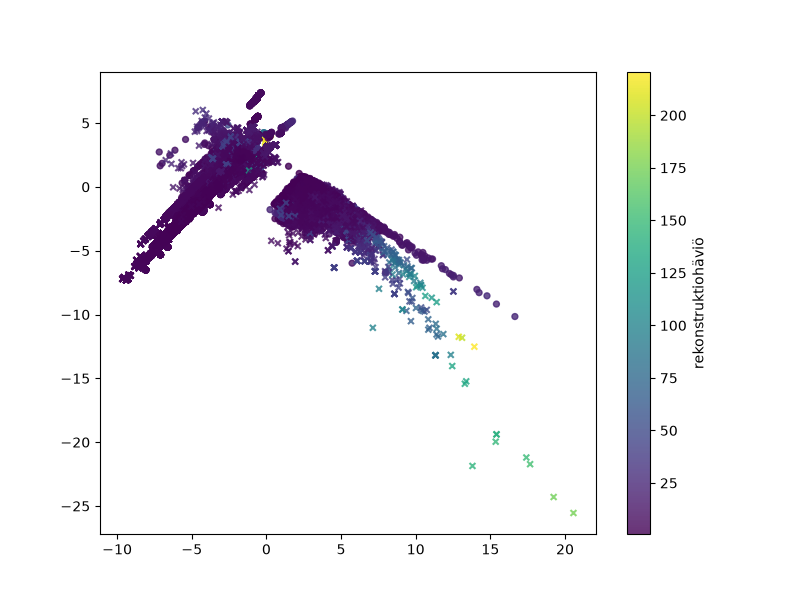
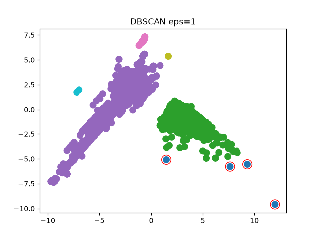

# Lopputyö

## Alustava tapauskansio
Alustavana sovellusalueena verkkotunkeutumisen havaitseminen ja datasettinä UNSW-NB15, train/test CSV. Verkkotunkeutumisen havaitsemisessa normaalin ja poikkeavan liikenteen havaitseminen on tärkeää. Huomaamalla verkkoliikenteessä esiintyviä poikkeamia, voidaan välttää ja estää mahdollisia tunkeutumisyrityksiä, sekä ylläpitää tietoturvaa. Havaitsemalla poikkeavaa liikennettä, voidaan tunnistaa mahdollisia yrityksiä tunkeutua järjestelmään. 

Normaalia dataa voisi olla tavalliset verkkoliikenteen toiminnot, kuten käyttäjien suorittamat toiminnot, keep-alive -viestit ja taustalla pyörivien sovellusten verkkoliikenne. Poikkeavaa dataa voisivat olla yllättävästä IP-osoitteesta tuleva liikenne, pingaukset ja lyhyessä aikavälissä saapuvat runsaat pyyntömäärät.

### 01 Mitä anomalia tarkoittaa

Verkkoliikenteessä pisteanomalia saattaisi olla erikoinen FTP-protokollan kirjautumisyritys tai suuri pakettimäärä. Kontekstuaalinen anomalia saattaisi taas olla useampi yllättävä FTP kirjautumisyritys etenkin, jos FTP ei ole käytössä kohdejärjestelmissä. Kollektiivisia anomalioita voi esiintyä verkkoliikenteen seassa, sillä aineistossa yksittäinen lokimerkintä ei saata itsessään nostaa hälytystä, kun taas kokoelma poikkeuksia voisi olla huomionarvoista. Tässä työssä käytämme termiä havainto yksittäisestä lokimerkinnästä.

UNSW-SB15 aineiston havaintoyksikkö on verkkoliikennetapahtuma/lokimerkintä verkkoliikenteestä. Aineistossa normaalia käyttäytymistä voi olla toisinaan hankala erottaa anomaliasta ilman laajempaa kontekstia, mutta joitakin asioita kannattaa havaita: käytetty protokolla/palvelu ja kättelyvaihe, lähetysnopeus, lähetettyjen ja vastaanotettujen pakettien suuruus sekä määrä. Normaalisti näiden arvot ovat oletettujen arvojen sisällä, eikä esimerkiksi lähetettyjen tavujen määrä ole valtava. Eräs poikkeama voisi olla huomattavan suuri lähetettyjen tavujen määrä. Toinen poikkeama voisi olla liian tasaiset lukemat esimerkiksi lähetettyjen bittien lähetyskuormassa ja lähetysnopeudessa. Esimerkkinä tällaisesta havainnosta olisi lähetysnopeus (rate) 111111.1 ja vastaava lähetyskuorma (sload) 88888888. Koska aineistosta löytyy valmiit label-arvot, voidaan asetelmaksi ottaa alustavasti ohjattu anomalian havaitseminen. Aineistossa on runsaasti merkittyä poikkeamadataa, kuten myös normaalia käyttäytymistä.

### 02 Datatyypit ja datamatriisi

Tässä lopputyössä alustavana aineistona on UNSW-NB15 datasetti, jossa on synteettistä verkkoliikennettä kategorisoituna tunnistettuihin hyökkäyksiin tai normaaliin liikenteeseen. Vaihtoehtoisena aineistona voisi olla KDD Cup 1999 10 percent. UNSW-NB15 aineiston viitteet löytyvät tämän kansion README.md tiedostosta. Test CSV on noin 15MB ja training CSV noin 32MB. Aineistosta on löydettävissä myös datamatriisin piirteet selitettyinä, kuten myös havaitut poikkeamat listassa.  Aineisto on akateemisessa käytössä vapaasti hyödynnettävissä, kun alkuperäisiin artikkeleihin viitataan oikeaoppisesti. Aineiston tärkeimpiä sarakkeita ovat kesto (dur), protokolla (proto), palvelu (service), lähettäjän ja kohteen tavut (sbytes, dbytes) sekä pakettinopeus (rate). Sarakkeita on kymmeniä kappaleita, joista osa on tärkeämpiä kuin toiset. Edellä mainitut ovat mielekkäimpiä tutkia yksittäisten havaintojen kohdalta, mutta muut sarakkeet tarjoavat niin ikään hyödyllistä tietoa. Aineistossa on olemassa valmiit label-arvot. Label kertoo, onko havainto poikkeava/anomalia binäärisesti ja attack_cat kertoo valmiiksi havaitun hyökkäysluokan. 

### 03 Esikäsittely ja skaalaus

Aineiston numeeriset piirteet:
- Kesto (dur)
- Lähetetyt paketit (spkts, dpkts)
- Lähetetyt tavut (sbytes, dbytes)
- Lähetysnopeus (rate)
- Lähetysten time-to-live (sttl, dttl)
- Lähetysten bittitahti (sload, dload)
- Pudotetut ja uudelleen lähetetyt paketit (sloss, dloss)

Kategoriset piirteet:
- Protokolla (proto)
- Palvelu (service)
- Vaihe (state)

Puuttuvat arvot:
- Palvelun arvo puuttuu usein.

Aikaleimat:
- Aikaleimoja ei ole, mutta tunnusluku (id) voidaan tulkita aikajärjestykseksi.

Numeeristen piirteiden arvot vaihtelevat merkittävästi. Lähetetyt tavut eroavat merkittävästi esimerkiksi lähetetyistä paketeista, joten näitä tulee skaalata lähemmäksi toisiaan. Protokolla, palvelu ja vaihe tulee koodata jollakin tarkoituksenmukaisella esitystavalla. Näiden arvoja ei voi asettaa järjestykseen mielekkäällä tavalla. Mallista jätetään pois attack_cat ja label, jotka eivät kuulu syötearvoiksi. 

### Esikäsittelysuunnitelma

1. Skaalataan aineiston numeeriset piirteet siten, että niiden arvojen eroavaisuudet eivät vaikuta merkittävästi tulkintaan mahdollisista poikkeamista. Taustalla päätöksessä on merkittävät eroavaisuudet arvojen mittakaavoissa.

2. Skaalataan kategoriset piirteet tarkoituksenmukaisesti esimerkiksi one-hot-koodauksella. Protokolla voidaan esimerkiksi one-hot-koodata siten, että yksittäinen protokolla saa oman binäärisen arvon saavan sarakkeen. Kategoristen piirteiden esikäsittelyssä on muistettava, ettei niitä tule esittää suoraan numeerisin arvoin

3. attack_cat ja label piirteet jätetään käsittelyn ulkopuolelle, eikä niitä käytetä syötearvoina. 

4. Palvelun arvo puuttuu usein, minkä vuoksi se ei välttämättä ole mielekäs piirre hyödyntää anomalian havaitsemisessa. Puuttumisella
viitataan merkkijonoarvoon "-", joka voidaan tulkita puuttuvana.
Aineistosta ei löydy null-arvoja lainkaan. 

skriptit/esikasittely_tarkistus.py sisältää tarkistuksen, joka selvittää datan muodon, puuttuvien arvojen määrän ja numeeristen sarakkeiden minimi- ja maksimiarvot.

### 04 Lineaarialgebran minimi

Datamatriisina tulkittuna UNSW-NB15 aineiston matriisin koko n x p on (82332, 45). Rivit ovat havaintoja ja sarakkeet ovat piirteitä. Transpoosi voisi olla hyödyllistä, jos haluamme vertailla piirteiden saamia arvoja keskenään. Piirrevektoreita voisi hyödyntää kyseisen aineiston analysoinnissa laskennan nopeuttamiseksi, kun vektorille voidaan tehdä operaatioita ilman tarvetta laskea kaikkia havaintoja yksi kerrallaan läpi. Matriisituloa voidaan myös hyödyntää laskennan tehostamiseksi. Myös esimerkiksi neuroverkoissa hyödynnetään matriisituloja.

### 05 Kovarianssi

Skriptit kansiosta löytyvä kovarianssi.py tiedosto sisältää Python skriptin, jolla voidaan laskea koko aineiston kovarianssi sarakkeittain. Skripti luo kovarianssi.csv tiedoston, josta löytyy matriisi sarakkeiden kovarianssista. Kovarianssista voi päätellä, että arvon ollessa positiivinen, muuttujat ovat usein keskiarvonsa ylä- tai alapuolella. Negatiivinen kovarianssi tarkoittaa, että toinen on usein yläpuolella, kun toinen on vastaavasti alhaalla. Datasta on hankala päätellä mitään, sillä dataa ei ole vielä skaalattu. Skaalaus on tehtävä uudestaan ennen kovarianssin laskentaa.

### 06 Etäisyydet ja tilastolliset pisteet

Tässä vaiheessa on hyvä skaalata aineisto. skaalaus.py tiedosto sisältää tarvittavat skaalaukset, kuten one-hot-koodaukset kategorisille muuttujille, sekä robusti skaalaus numeerisille arvoille. Samalla aineistosta pudotetaan pois id, attack_cat ja label.

UNSW-NB15 aineistosta voidaan laskea Mahalanobis-etäisyys eri piirteiden yhteisvaihtelun mukaan. Skripti mahal.py tarjoaa työkalut etäisyyksien laskemiseksi. Voimme valita esimerkiksi keston, lähetysnopeuden sekä lähetetyt että vastaanotetut tavut verrattaviksi piirteiksi. Voimme laskea suhteellisen suoraviivaisesti kaikki aineiston piirteiden havainnot ja niiden Mahalanobis-etäisyydet. Seuraavassa taulukossa on viisi suurinta havaittua etäisyyttä skaalatun aineiston havainnoista.

|id      | Mahalanobis-etäisyys     |
|--------|---------------           |
|72488   |  102.209753              |
|82938   |  101.044580              |
|121100  |  89.456678               |
|99846   |  86.543091               |
|97188   |  74.375154               |

Mahalanobis-etäisyyden kaava vertaa etäisyyttä aineiston pisteiden jakauman välillä, kun piirteet korreloituvat jotenkin. Maksimeista ei voida vielä todeta merkittävää anomaliaa ilman laajempaa kontekstia datan muodosta ja sen poikkeamien muodosta. On kuitenkin tärkeää tarkastaa ylläolevat maksimit, sillä niiden etäisyys poikkeaa suurimmasta osasta etäisyyksistä.

### 07 Arviointi ja metriikat

Voimme hyödyntää arvioinnissa precision ja recall arvoja. Valmiit label-arvot tarjoavat mahdollisuuden laskea TP, TN, FP ja FN lukumäärät. 

Aineistosta löytyvät label-arvot toimivat erinomaisena työkaluna tulosten tarkastukseen. Binäärinen normaali/anomalia tilastointi voidaan toteuttaa melko luotettavasti. Accuracy ei ole aina luotettavin metriikka anomalian havaitsemisessa, sillä korkea accuracy saattaa silti sisältää kymmeniä tai satoja havaitsemattomia anomalioita. Tuloksia on tarkasteltava myös recall- ja,precision-arvojen  mukaisesti

### 08 Kynnys ja virheanalyysi

Tietoliikenteen tapauksessa analyysissä kalliimmaksi saattaisivat tulla väärät negatiiviset, jolloin todellinen anomalia jäisi huomaamatta. Hälytyksien tarkastaminen voi toki tulla kalliiksi riippuen tavasta tarkastaa. Jos valvoja tarkastaa ne manuaalisesti, saattaa olla järkevää kohottaa kynnystä.

### 09 Least squares ajattelu

sbytes on muuttujana ennustettavissa aineiston muiden piirteiden perusteella. Esimerkiksi spkts selittää sbytes liikehdintää ja sen  suuntaa, kuten myös rate ja dur yhdessä. 

Voimme hyödyntää aineistossa residuaalibaselinea, sillä esimerkiksi sbytes on ennustettava muuttuja aineistossa. Ajamalla pienen Python skriptin skriptit\least_squares.py, voimme verrata dur ja sbytes piirteitä ja havaita suuria residuaaleja.

Saadaan seuraavanlainen taulukko:

|indeksi | residuaali   |
|--------|--------------|
|97188   |  9693.771164 |
|62042   |  9409.330132 |
|61679   |  8977.055819 |
|98993   |  8841.894667 |
|121110  |  8235.446699 |
|.....   | ......       |
|107606  | -248.944002
|109177  | -248.944018
|109101  | -248.944018
|109178  | -248.944018
|109174  | -248.944018

Name: sbytes, dtype: float64 

### 10 PCA ja rekonstruktio

Alla olevassa kaaviossa nähdään aineiston pääkomponenttianalyysi. Pisteet ovat väritetty aineiston todellisten label-arvojen mukaan, minkä avulla voimme havaita poikkeavien arvojen olevan pääasiassa oikeita anomalioita.

|indeksi    | rekonstruktiohäviö    |label  |
|-----------|-------------------    |-------|
|20808      |    432.468236         |   0   |
|20806      |    432.468171         |   0   |
|18916      |    432.467972         |   0   |
|23251      |    418.794315         |   0   |
|99355      |    220.600355         |   1   |

### 11 Satunnaisprojektiot

UNSW-NB15 aineistossa on runsaasti piirteitä. Sarakkeita on 44 pl. indeksi, joista 42 on aitoja piirteitä. attack_cat ja label jätetään huomiotta. Dimensioiden pienentäminen voisi olla hyvä esikäsittely aineistolle, koska havaintoja on lähes 200 000 kappaletta ja piirteitä on lähes 50.

### 12 Klusterointi ja tiheys

Valitsemalla satunnaisesti noin 10000 havaintoa aineistosta pääkomponenttianalyysin jälkeen, voidaan havaita aineiston jakautuvan kolmeen ryhmään DBSCAN menetelmän avulla. Yksi havaintopiste tulkitaan kohinaksi. 

### 13 kNN ja paikallinen poikkeavuus

Pääkomponenttianalyysin jälkeen aineistosta olisi hyvä selvittää Local Outlief Factor menetelmällä poikkeamia suhteessa havainnon omaan naapurustoon. DBSCAN klusterointi esitti datan jakautuvan 10000 havainnon satunnaisotannassa neljään ryhmään eps-arvolla 2. Lokaalit poikkeavuudet olisivat mielenkiintoisia tutkittavia. 

Saamme lof poikkeavuusarvojen maksimeiksi 
|           | lof poikkeavuusarvo
|-----------|------------------------|
|48868      |    2.406812e+09
|49205      |    2.406812e+09
|43587      |    1.040493e+09
|43588      |    1.040493e+09
|118337     |    8.287126e+08

### 14 Vanhemmat kNN menetelmät

### 15 Tukivektorikoneen periaatteet

Normaalin alueen rajaaminen tukivektorikoneen ajatuksen avulla on mielekästä kyberturvallisuuden verkkoliikenteen analysoinnissa. Esikäsittelyn jälkeen dataa voisi tarkastella rajaamalla normaalin alueen rajapinta mielekkäästi. Koska aineistossa on label-arvot, helpottaa se rajauksen tekoa merkittävästi.

### 16 One-class SVM

Aineistosta on mahdollista valita normaaleja havaintoja label-arvojen avulla. Ilman suodattamista training data sisältää melko paljon tunnistettuja poikkeamia, jolloin one-class SVM voisi oppia väärän normaalin. Data on myös skaalattava tarkasti, jotta RBF-kernel ei mittaa etäisyyksiä väärin. Käytännössä one-class svm ei sovi UNSW-NB15 aineistolle menetelmänä, sillä aineisto tulisi käytännössä suodattaa label-arvojen perusteella normaaliin ja poikkeavaan dataan. Verkkoliikenteessä normaali saattaa myös muuttua, mikä voi lisätä vääriä hälytyksiä entisestään. nu-parametri pyrkii sovittamaan rajalla olevia havaintoja normaaliksi tai poikkeamiksi. Käytännössä tämä vaikuttaa rajan pehmeyteen, jossa suurempi arvo vetää rajan tiukemmin. RBF-kernelin parametrina gamma vaikuttaa rajan tasaisuuteen. 

### 17 Isolation forest

Ajamalla Isolation forest -menetelmä aineistolle contamination arvolla 0.4, saadaan seuraavat havainnot suurimmiksi poikkeusarvoiksi:
|indeksi |    poikkeavuusarvot
|----------|-------------------

80047           0.651327
52761           0.622420
103845          0.621750
135921          0.617438
153524          0.617438

Listauksen suurimmat poikkeavuusarvot eroavat aiemmista menetelmistä. Käytännössä tähän vaikuttaa aineiston skaalaamattomuus sekä menetelmän poikkeavuuden korostamisen keino. 

### 18 PyOD-työnkulku

Ajamalla PyOD:n avulla LOF sekä IForest contamination arvoille 0.1, saadaan seuraavanlainen taulukko

|          | LOF   | IForest |
|----------|-------|---------|
| parametri|n_neighbours|contamination|
| top-5    |[157554 130063  46411 174961  97695]| [100451 103845  80047 112818  65761]|

Tulkinta: Aineisto on niin laaja, että top-5 havaintojen päällekkäisyyksiä ei juurikaan tule. Samalla contamination arvolla ajetut menetelmät tuottavat runsaasti läheisiä tuloksia, minkä vuoksi pienessä otannassa päällekkäisyyksiä ei nähdä. Olisi suotavaa tutkia suuremman top-listan päällekkäisyyksiä tai ajaa menetelmät pienemmällä satunnaisotannalla.

### 20 Autoenkooderit

Aineisto on suuri ja numeerista esikäsittelyä on suoritettu. Autoenkooderi voisi toimia hyvin poikkeavuusarvona aineistolle. Vaikeuksia saattaisi ilmetä suuresta poikkeavien havaintojen määrästä koulutusaineistossa, jolloin autoenkooderi ei välttämättä osaa rekonstruoida normaalia dataa poikkeavaa dataa paremmin.

Ajamalla autoenkooderi skripti, saadaan seuraavanlainen top 5 -lista:
100451, 112818, 103845, 172965, 80047. Tämä lista on hyvin lähellä aiemmin ajettua Isolation Forest menetelmän tuottamaa listausta. Rekonstruktiohäviön jakauma on ääripäistä seuraavanlainen: 152.5  152.56 ... 20.62 21.62. Koska rekonstruktiohäviö on niin suuri, ei optimointia ole suoritettu mahdollisimman hyvin. Seuraavien ajojen aikana on parannettava optimointia.

### 21 Aikasarja-anomaliat

Aineistossa ei ole aikaulottuvuutta, sillä aineiston järjestys ei määräydy välttämättä ajan mukaan. Jos aineisto on aikajärjestyksessä, ei tapahtumien välistä aikaa ole tiedossa, minkä vuoksi datan aikavälejä on hankala tulkita. Koska aineisto on verkkoliikenteen loki, sen käsittely taulukkona 

Aineisto on tavallinen taulukko, sillä datan järjestyksestä ei ole täyttä varmuutta, eikä aikaleimoja havainnoilla ole. Havaintoyksikkönä on yksi verkkoliikenteen lokimerkintä. Aineisto voi olla myös sekvenssiaineisto, sillä verkkoliikenne on hyvin usein järjestyksessä kirjattu. Tätä myös korostaa verkkoliikenteen peräkkäisten lokimerkintöjen samankaltaiset piirteet. 

### 22 Transformer- ja embedding-ajattelu

Embedding, attention ja transformer voivat olla aineistoon nähden melko raskaita suoritettavia olemassaolevilla resursseilla. Aiemmat menetelmät, kuten Isolation Forest tai neuroverkot ovat todennäköisesti yhtä hyödyllisiä tai hyödyllisempiä. Niiden selkeys on myös iso etu. 