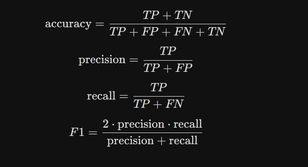

# Lopputyö

## Alustava tapauskansio
Alustavana sovellusalueena verkkotunkeutumisen havaitseminen ja datasettinä UNSW-NB15, train/test CSV. Verkkotunkeutumisen havaitsemisessa normaalin ja poikkeavan liikenteen havaitseminen on tärkeää. Huomaamalla verkkoliikenteessä esiintyviä poikkeamia, voidaan välttää ja estää mahdollisia tunkeutumisyrityksiä, sekä ylläpitää tietoturvaa. Havaitsemalla poikkeavaa liikennettä, voidaan tunnistaa mahdollisia yrityksiä tunkeutua järjestelmään. 

Normaalia dataa voisi olla tavalliset verkkoliikenteen toiminnot, kuten käyttäjien suorittamat toiminnot, keep-alive -viestit ja taustalla pyörivien sovellusten verkkoliikenne. Poikkeavaa dataa voisivat olla yllättävästä IP-osoitteesta tuleva liikenne, pingaukset ja lyhyessä aikavälissä saapuvat runsaat pyyntömäärät.

### 01 Mitä anomalia tarkoittaa

Verkkoliikenteessä pisteanomalia saattaisi olla erikoinen ftp kirjautumisyritys tai suuri pakettimäärä. Kontekstuaalinen anomalia saattaisi taas olla useampi yllättävä ftp kirjautumisyritys etenkin, jos FTP ei ole käytössä kohdejärjestelmissä. Kollektiivisia anomalioita voi esiintyä verkkoliikenteen seassa, sillä aineistossa yksittäinen lokimerkintä ei saata itsessään nostaa hälytystä, kun taas kokoelma poikkeuksia voisi olla huomionarvoista. Tässä työssä käytämme termiä havainto yksittäisestä lokimerkinnästä.

UNSW-SB15 aineiston havaintoyksikkö on verkkoliikennetapahtuma/lokimerkintä verkkoliikenteestä. Aineistossa normaalia käyttäytymistä voi olla toisinaan hankala erottaa anomaliasta ilman laajempaa kontekstia, mutta joitakin asioita kannattaa havaita: käytetty protokolla/palvelu ja kättelyvaihe, lähetysnopeus, lähetettyjen ja vastaanotettujen pakettien suuruus sekä määrä. Normaalisti näiden arvot ovat oletettujen arvojen sisällä, eikä esimerkiksi lähetettyjen tavujen määrä ole valtava. Eräs poikkeama voisi olla huomattavan suuri lähetettyjen tavujen määrä. Toinen poikkeama voisi olla liian tasaiset lukemat esimerkiksi lähetettyjen bittien lähetyskuormassa ja lähetysnopeudessa. Esimerkkinä tällaisesta havainnosta olisi lähetysnopeus (rate) 111111.1 ja vastaava lähetyskuorma (sload) 88888888. Koska aineistosta löytyy valmiit label-arvot, voidaan asetelmaksi ottaa alustavasti ohjattu anomalian havaitseminen. Aineistossa on runsaasti merkittyä poikkeamadataa, kuten myös normaalia käyttäytymistä.

### 02 Datatyypit ja datamatriisi

Tässä lopputyössä alustavana aineistona on UNSW-NB15 datasetti, jossa on synteettistä verkkoliikennettä kategorisoituna tunnistettuihin hyökkäyksiin tai normaaliin liikenteeseen. Vaihtoehtoisena aineistona voisi olla KDD Cup 1999 10 percent. UNSW-NB15 aineiston viitteet löytyvät tämän kansion README.md tiedostosta. Test CSV on noin 15MB ja training CSV noin 32MB. Aineistosta on löydettävissä myös datamatriisin piirteet selitettyinä, kuten myös havaitut poikkeamat listassa.  Aineisto on akateemisessa käytössä vapaasti hyödynnettävissä, kun alkuperäisiin artikkeleihin viitataan oikeaoppisesti. Aineiston tärkeimpiä sarakkeita ovat kesto (dur), protokolla (proto), palvelu (service), lähettäjän ja kohteen tavut (sbytes, dbytes) sekä pakettinopeus (rate). Sarakkeita on kymmeniä kappaleita, joista osa on tärkeämpiä kuin toiset. Edellä mainitut ovat mielekkäimpiä tutkia yksittäisten havaintojen kohdalta, mutta muut sarakkeet tarjoavat niin ikään hyödyllistä tietoa. Aineistossa on olemassa valmiit label-arvot. Label kertoo, onko havainto poikkeava/anomalia binäärisesti ja attack_cat kertoo valmiiksi havaitun hyökkäysluokan. 

## 03 Esikäsittely ja skaalaus

Aineiston numeeriset piirteet:
- Kesto (dur)
- Lähetetyt paketit (spkts, dpkts)
- Lähetetyt tavut (sbytes, dbytes)
- Lähetysnopeus (rate)
- Lähetysten time-to-live (sttl, dttl)
- Lähetysten bittitahti (sload, dload)
- Pudotetut ja uudelleen lähetetyt paketit (sloss, dloss)

Kategoriset piirteet:
- Protokolla (proto)
- Palvelu (service)
- Vaihe (state)

Puuttuvat arvot:
- Palvelun arvo puuttuu usein.

Aikaleimat:
- Aikaleimoja ei ole, mutta tunnusluku (id) voidaan tulkita aikajärjestykseksi.

Numeeristen piirteiden arvot vaihtelevat merkittävästi. Lähetetyt tavut eroavat merkittävästi esimerkiksi lähetetyistä paketeista, joten näitä tulee skaalata lähemmäksi toisiaan. Protokolla, palvelu ja vaihe tulee koodata jollakin tarkoituksenmukaisella esitystavalla. Näiden arvoja ei voi asettaa järjestykseen mielekkäällä tavalla. Mallista jätetään pois attack_cat ja label, jotka eivät kuulu syötearvoiksi. 

### Esikäsittelysuunnitelma

1. Skaalataan aineiston numeeriset piirteet siten, että niiden arvojen eroavaisuudet eivät vaikuta merkittävästi tulkintaan mahdollisista poikkeamista. Taustalla päätöksessä on merkittävät eroavaisuudet arvojen mittakaavoissa.

2. Skaalataan kategoriset piirteet tarkoituksenmukaisesti esimerkiksi one-hot-koodauksella. Protokolla voidaan esimerkiksi one-hot-koodata siten, että yksittäinen protokolla saa oman binäärisen arvon saavan sarakkeen. Kategoristen piirteiden esikäsittelyssä on muistettava, ettei niitä tule esittää suoraan numeerisin arvoin

3. attack_cat ja label piirteet jätetään käsittelyn ulkopuolelle, eikä niitä käytetä syötearvoina. 

4. Palvelun arvo puuttuu usein, minkä vuoksi se ei välttämättä ole mielekäs piirre hyödyntää anomalian havaitsemisessa. Puuttumisella
viitataan merkkijonoarvoon "-", joka voidaan tulkita puuttuvana.
Aineistosta ei löydy null-arvoja lainkaan. 

skriptit/esikasittely_tarkistus.py sisältää tarkistuksen, joka selvittää datan muodon, puuttuvien arvojen määrän ja numeeristen sarakkeiden minimi- ja maksimiarvot.

## 04 Lineaarialgebran minimi

Datamatriisina tulkittuna UNSW-NB15 aineiston matriisin koko n x p on (82332, 45). Rivit ovat havaintoja ja sarakkeet ovat piirteitä. Transpoosi voisi olla hyödyllistä, jos haluamme vertailla piirteiden saamia arvoja keskenään. Piirrevektoreita voisi hyödyntää kyseisen aineiston analysoinnissa laskennan nopeuttamiseksi, kun vektorille voidaan tehdä operaatioita ilman tarvetta laskea kaikkia havaintoja yksi kerrallaan läpi. Matriisituloa voidaan myös hyödyntää laskennan tehostamiseksi. Myös esimerkiksi neuroverkoissa hyödynnetään matriisituloja.

## 05 Kovarianssi

Skriptit kansiosta löytyvä kovarianssi.py tiedosto sisältää Python skriptin, jolla voidaan laskea koko aineiston kovarianssi sarakkeittain. Skripti luo kovarianssi.csv tiedoston, josta löytyy matriisi sarakkeiden kovarianssista. Kovarianssista voi päätellä, että arvon ollessa positiivinen, muuttujat ovat usein keskiarvonsa ylä- tai alapuolella. Negatiivinen kovarianssi tarkoittaa, että toinen on usein yläpuolella, kun toinen on vastaavasti alhaalla. Datasta on hankala päätellä mitään, sillä dataa ei ole vielä skaalattu. Skaalaus on tehtävä uudestaan ennen kovarianssin laskentaa.

## 06 Etäisyydet ja tilastolliset pisteet

Tässä vaiheessa on hyvä skaalata aineisto. skaalaus.py tiedosto sisältää tarvittavat skaalaukset, kuten one-hot-koodaukset kategorisille muuttujille, sekä robusti skaalaus numeerisille arvoille. Samalla aineistosta pudotetaan pois id, attack_cat ja label.

UNSW-NB15 aineistosta voidaan laskea Mahalanobis-etäisyys eri piirteiden yhteisvaihtelun mukaan. Skripti mahal.py tarjoaa työkalut etäisyyksien laskemiseksi. Voimme valita esimerkiksi keston, lähetysnopeuden sekä lähetetyt että vastaanotetut tavut verrattaviksi piirteiksi. Voimme laskea suhteellisen suoraviivaisesti kaikki aineiston piirteiden havainnot ja niiden Mahalanobis-etäisyydet. Seuraavassa taulukossa on viisi suurinta havaittua etäisyyttä skaalatun aineiston havainnoista.

|id      | Mahalanobis-etäisyys     |
|--------|---------------           |
|72488   |  102.209753              |
|82938   |  101.044580              |
|121100  |  89.456678               |
|99846   |  86.543091               |
|97188   |  74.375154               |

Mahalanobis-etäisyyden kaava vertaa etäisyyttä aineiston pisteiden jakauman välillä, kun piirteet korreloituvat jotenkin. Maksimeista ei voida vielä todeta merkittävää anomaliaa ilman laajempaa kontekstia datan muodosta ja sen poikkeamien muodosta. On kuitenkin tärkeää tarkastaa ylläolevat maksimit, sillä niiden etäisyys poikkeaa suurimmasta osasta etäisyyksistä.

## 07 Arviointi ja metriikat

Voimme hyödyntää arvioinnissa precision ja recall arvoja. Valmiit label-arvot tarjoavat mahdollisuuden laskea TP, TN, FP ja FN lukumäärät. 

Aineistosta löytyvät label-arvot toimivat erinomaisena työkaluna tulosten tarkastukseen. Binäärinen normaali/anomalia tilastointi voidaan toteuttaa melko luotettavasti. Accuracy ei ole aina luotettavin metriikka anomalian havaitsemisessa, sillä korkea accuracy saattaa silti sisältää kymmeniä tai satoja havaitsemattomia anomalioita. Tuloksia on tarkasteltava myös recall- ja,precision-arvojen  mukaisesti

## 08 Kynnys ja virheanalyysi

Tietoliikenteen tapauksessa analyysissä kalliimmaksi saattaisivat tulla väärät negatiiviset, jolloin todellinen anomalia jäisi huomaamatta. Hälytyksien tarkastaminen voi toki tulla kalliiksi riippuen tavasta tarkastaa. Jos valvoja tarkastaa ne manuaalisesti, saattaa olla järkevää kohottaa kynnystä.
